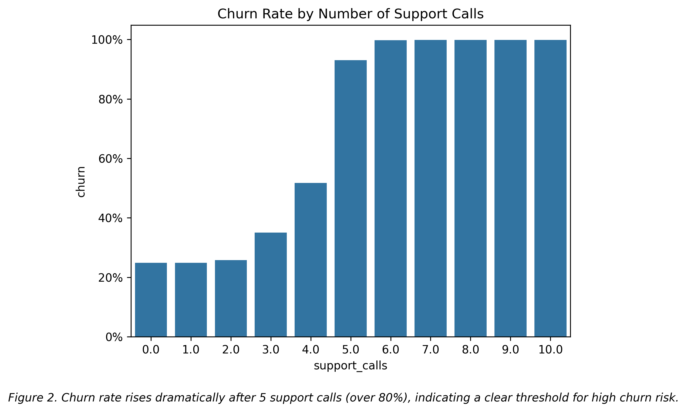
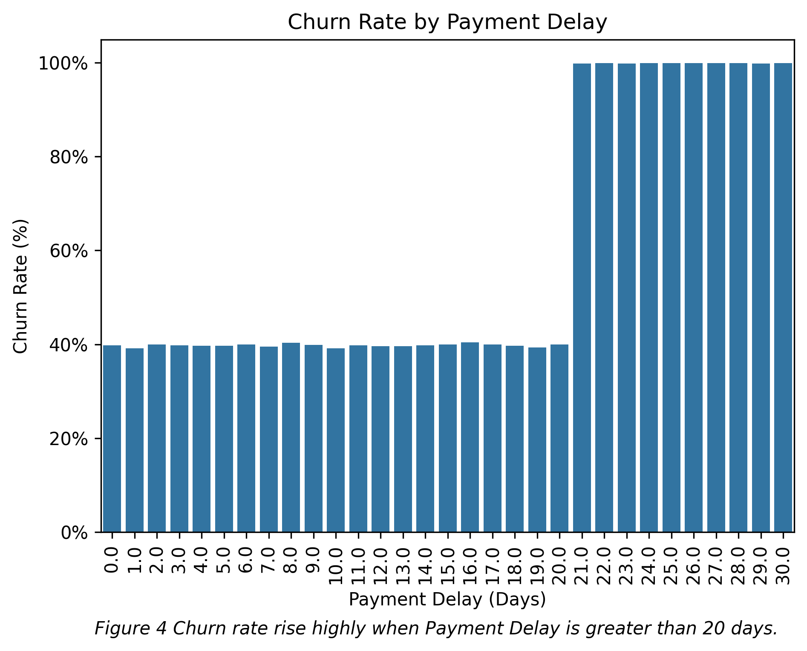
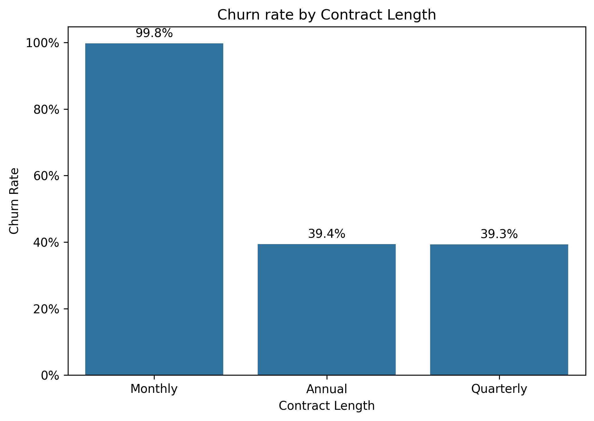
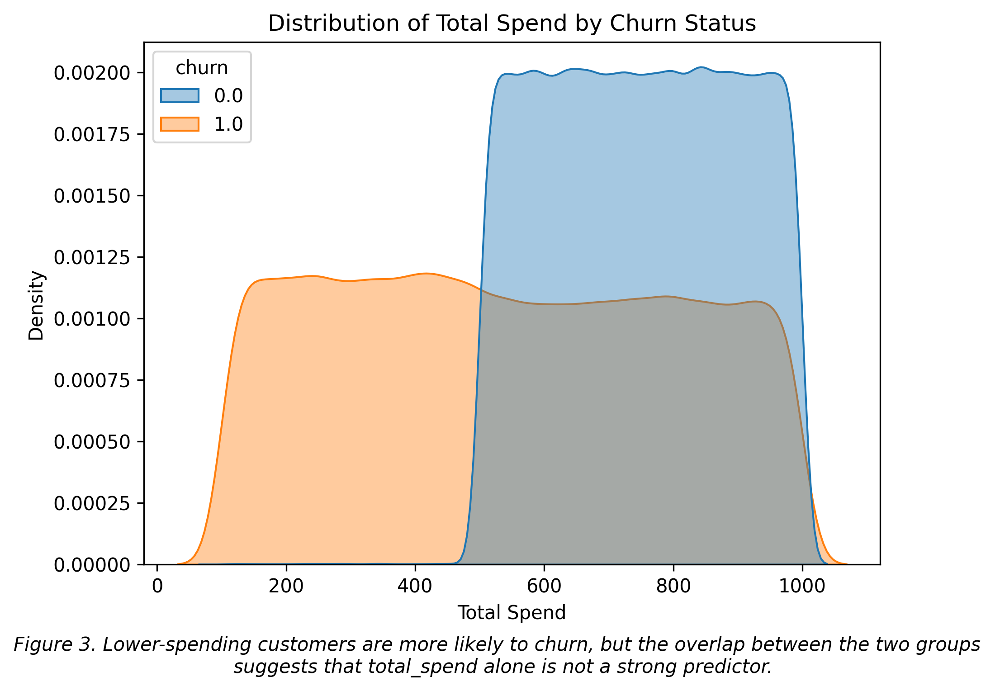
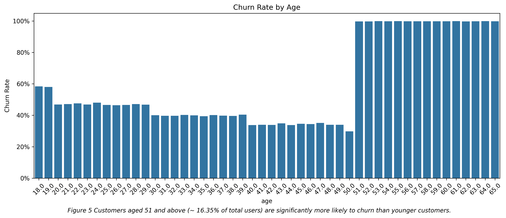

# Customer Churn Analysis – Exploratory Data Analysis (EDA)

## 1. Project Overview

This project explores customer churn data using Python to identify behavioral patterns and customer characteristics associated with churn.

The analysis aims to understand customer churn trends, investigate potential churn indicators, and derive business insights that could support customer retention strategies.

## 2. Dataset

- **Source:** Public dataset
- **Records:** 505,207 rows
- **Features:** 12 columns
- **Target Variable:** `churn`

## 3. Tools & Libraries

- **Python:** Main programming language
- **Google Colab:** Development environment
- **Pandas:** Data manipulation and analysis
- **NumPy:** Numerical operations
- **Matplotlib & Seaborn:** Data visualization

## 4. Data Preparation

The dataset was inspected and cleaned before conducting exploratory analysis.

Key steps included:

- Inspecting dataset dimensions, structure, and data types.
- Identifying numerical and categorical variables.
- Exploring feature distributions.
- Checking and removing duplicate records.
- Identifying and handling missing values.

## 5. Exploratory Data Analysis

The analysis examined the overall churn rate and explored its relationship with key customer characteristics and behavioral factors:

- Contract length
- Number of support calls
- Total spending
- Payment delay
- Customer age

## 6. Key Insights

### 6.1. Support Calls and Churn

Customers making **more than 5 support calls** exhibit a dramatically higher churn rate. Frequent support interactions may indicate unresolved issues or customer dissatisfaction, making support call frequency a potential indicator of churn risk.

### 6.2. Payment Delay and Churn

Customers with payment delays of **21 days or more** show an extremely high churn rate, while those with shorter delays maintain substantially lower churn rates. Payment delay may therefore serve as an important signal for identifying customers at risk of leaving.

### 6.3. Contract Length and Churn

Customers on **Monthly contracts** have an exceptionally high churn rate (approximately 99.8%), compared with customers on Annual or Quarterly contracts. This suggests a strong association between contract length and customer retention.

### 6.4. Total Spending and Churn

Customers with total spending **below 500** tend to exhibit higher churn rates. However, overlapping spending distributions between churned and retained customers suggest that spending alone cannot fully explain churn behavior.

### 6.5. Customer Age and Churn

Customers aged **51 and above** exhibit a noticeably higher churn rate than younger age groups, suggesting that age may be associated with differences in customer retention patterns.

## 7. Conclusion

The analysis highlights several customer characteristics and behavioral factors associated with churn, particularly support call frequency, payment delays, and contract length.

These findings suggest potential opportunities for customer retention initiatives, including prioritizing customers with repeated support requests, monitoring delayed payments, and examining retention patterns across different contract types.

As an exploratory analysis, these findings indicate associations rather than causal relationships. Further statistical analysis and predictive modeling would be required to assess their predictive value.

## 8. Project Notebook

For the complete Python code and detailed analysis, see [Customer Churn EDA Notebook](Notebook/Customer_churn_eda.ipynb).
